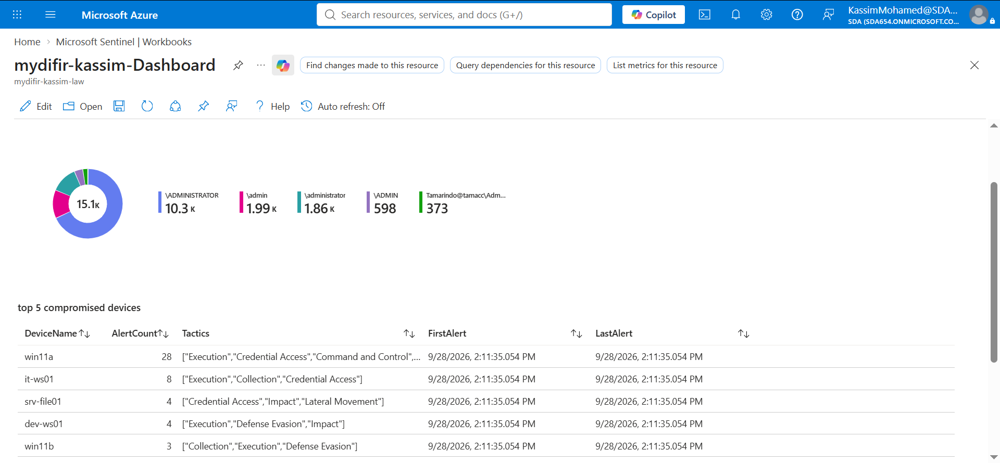
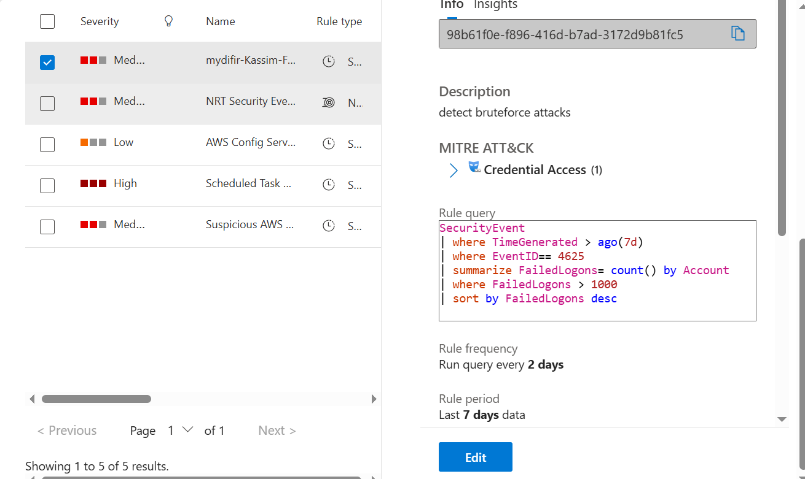
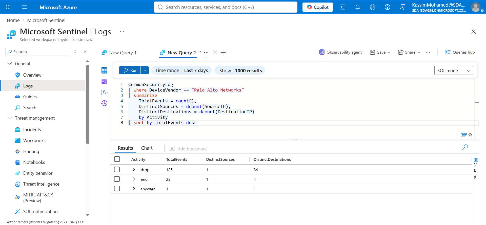

# Week One — Microsoft Sentinel SOC Lab

**MYDFIR Forge — 30-Day Microsoft Challenge**

## Project Overview

As part of the **MYDFIR Forge 30-Day Microsoft Challenge**, I completed Project 01 by building a hands-on security monitoring lab using **Microsoft Sentinel**, a cloud-based SIEM solution.

The main goal of this project was to build a working SOC environment, collect security logs, create detections, investigate alerts, and practice threat hunting using Kusto Query Language (KQL).

---

## Lab Setup

I created an Azure environment and deployed the following resources:

1. **Windows Virtual Machine**
   Deployed a Windows virtual machine to generate and analyze security events as part of the lab.

2. **Azure Resource Group**
   Created a resource group named `mydifir-kassim-RG` in the **East US** region to organize the Azure resources used in the lab.

3. **Log Analytics Workspace**
   Created a Log Analytics workspace named `mydifir-kassim-LAW` to collect, store, and query security log data.

4. **Microsoft Sentinel**
   Added Microsoft Sentinel to the Log Analytics workspace to provide SIEM capabilities for security monitoring, detection, investigation, and threat hunting.

5. **Microsoft Sentinel Training Lab**
   Deployed the Microsoft Sentinel Training Lab, which provides sample security data for different investigation and detection use cases.

---

---

## Detection & Investigation

After setting up the environment, I moved from infrastructure setup into practical SOC activities.

### Brute-Force Detection

* Created a Microsoft Sentinel analytics rule to detect repeated failed authentication attempts.
* Configured the rule to run every **5 minutes**.
* Investigated the alert generated by the analytics rule.
* Analyzed the available authentication events to understand the activity and determine what the logs could not demonstrate.

### Threat Hunting

I also performed threat hunting against `OfficeActivity_CL` logs.

During the investigation:

* Searched for suspicious activity and known indicators.
* Identified suspicious IP addresses.
* Added relevant findings as **Microsoft Sentinel bookmarks** for further investigation and reference.

### Detection & KQL

I used **Kusto Query Language (KQL)** to search and analyze security data and developed queries to identify suspicious activity and potential **Indicators of Attack (IOAs)**.

---

## Skills Gained

Through this project, I developed practical experience in:

* Creating and managing basic resources in **Microsoft Azure**.
* Setting up a **Log Analytics Workspace**.
* Deploying and configuring **Microsoft Sentinel**.
* Understanding the basic structure and syntax of **Kusto Query Language (KQL)**.
* Creating and configuring **Microsoft Sentinel analytics rules**.
* Investigating security alerts.
* Performing threat hunting using security logs.
* Searching for known **Indicators of Compromise (IOCs)** using threat intelligence.
* Using **MDTI** to support threat hunting.
* Creating bookmarks to document suspicious findings.
* Developing more advanced KQL queries to identify potential **Indicators of Attack (IOAs)**.
* Troubleshooting Azure deployment and subscription issues.

---

## Challenges & Troubleshooting

Deploying the Microsoft Sentinel Training Lab presented several challenges. The sample data was no longer available directly through the Content Hub, so I used the provided deployment script on github.

The deployment initially failed because the script attempted to create a second Azure Automation account, while my Azure trial subscription had a regional limitation allowing only one Automation account. I resolved the issue by upgrading the subscription. When I encountered an issue during the upgrade process, I contacted Microsoft Support, who helped resolve the subscription issue.

After resolving these issues, I successfully deployed the Sentinel Training Lab and began working with the sample security data.

**Key takeaway:** This experience strengthened my Azure troubleshooting skills and taught me the importance of analyzing deployment errors, understanding cloud resource limitations, and systematically identifying the root cause of infrastructure problems.

## Tools & Technologies

* Microsoft Azure
* Microsoft Sentinel
* Log Analytics
* Kusto Query Language (KQL)

---

## Screenshots

### Microsoft Sentinel Dashboard

### Brute-Force Analytics Rule

### Threat Hunting

### Sentinel Training Lab

## Reflection

This project helped me move from learning security concepts to applying them in a practical SOC environment.

I gained a better understanding of how security logs are collected and analyzed in Microsoft Sentinel, how KQL can be used to investigate large amounts of log data, and how detections can be created to identify suspicious activity.

The deployment challenges were also an important part of the learning experience. Troubleshooting the failed Training Lab deployment required me to investigate Azure resources, understand subscription limitations, work through a subscription upgrade issue, and communicate with Microsoft Support to resolve the problem.

I also learned that **having a large number of security events does not automatically mean that an attack was successful**. Investigation requires context, correlation, and sufficient evidence before reaching a conclusion.

I will continue building on these skills in the next projects of the **MYDFIR Forge 30-Day Microsoft Challenge**.
