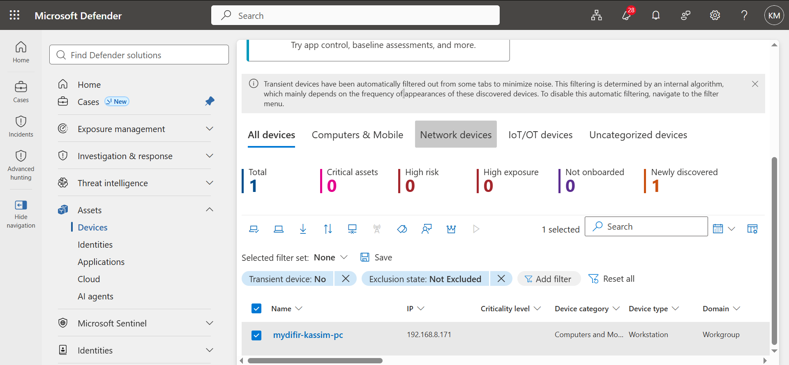
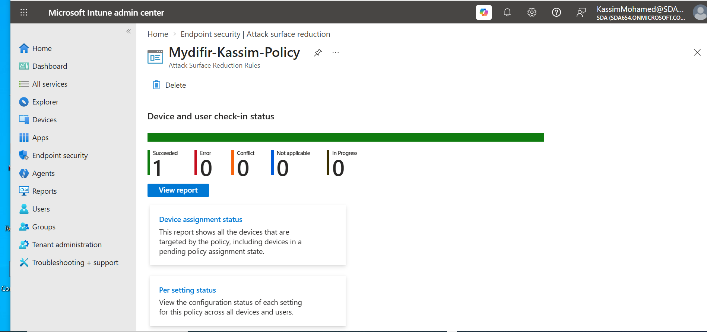
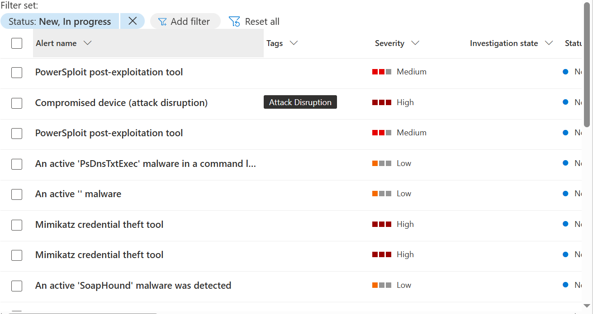

# Week Three: Endpoint Security with Microsoft Defender for Endpoint

During Week Three of my [30-Day MyDFIR Microsoft Challenge](https://github.com/Kassimali/30-Day-MyDFIR-Microsoft-Challenge/tree/main), I focused on endpoint security using Microsoft Defender for Endpoint and Microsoft Intune.

The main objectives were to onboard a Windows lab device, configure endpoint security policies, simulate suspicious activity using Atomic Red Team, and investigate the alerts generated by Microsoft Defender.

## Task 1: Configure and Onboard a Windows Endpoint

### Microsoft Defender for Endpoint Configuration

Before onboarding the device, I reviewed and enabled selected features under the endpoint settings in the Microsoft Defender portal:

- **EDR in block mode:** Allows Microsoft Defender Antivirus to remediate detected threats identified by endpoint detection and response capabilities, subject to supported configurations.
- **Custom network indicators:** Allows configured IP addresses, domains, and URLs to be used in network protection decisions.
- **Web content filtering:** Helps monitor and control access to websites based on configured content categories.
- **Microsoft Intune connection:** Integrates Defender for Endpoint with Intune to support device management and security policy enforcement.

### Device Onboarding

I set up a Windows 10 virtual machine locally in VirtualBox and onboarded it to Microsoft Defender for Endpoint using the local onboarding script for Windows 10 and Windows 11.

I then verified that the device appeared in the Devices section of the Microsoft Defender portal and explored the available endpoint management capabilities.

I also connected Microsoft Defender XDR with Microsoft Sentinel to explore how endpoint security alerts can be incorporated into broader security monitoring and investigation workflows.

## Task 2: Configure Attack Surface Reduction Policies

I explored Microsoft Intune, particularly the Endpoint Security section, and created an Attack Surface Reduction (ASR) policy for my test device.

Before applying the policy, I configured the relevant Windows device management settings and joined the test VM to the organization's domain. I then assigned the ASR policy to the test device and validated its application.

ASR rules help reduce the attack surface by blocking or restricting behaviors commonly abused by attackers.

Examples of behaviors addressed by ASR rules include:

- Office applications creating suspicious child processes.
- Credential theft attempts involving LSASS.
- Suspicious executable content downloaded from the internet.
- Other risky behaviors commonly associated with malware.

I also reviewed other endpoint security profiles available in Intune.

### Other Endpoint Security Profiles Explored

- **Device Control:** Helps manage removable storage and other supported peripheral devices to reduce the risk of data loss and malware introduction.
- **Application and Browser Isolation:** Provides isolation capabilities for supported scenarios involving potentially untrusted content.
- **Application Control:** Helps restrict which applications and scripts are allowed to execute, depending on the configured technology and policy.
- **Exploit Protection:** Applies operating system and application-level mitigations to help defend against exploitation attempts.

This exploration helped me understand how endpoint security policies can be combined to reduce the risk of malware execution, credential theft, and other attack techniques.

## Task 3: Simulate Suspicious Activity Using Atomic Red Team

To test endpoint detection and response capabilities, I installed Atomic Red Team and executed a test associated with **MITRE ATT&CK T1059.001 — PowerShell**.

After running the simulation, Microsoft Defender for Endpoint generated multiple alerts, including detections associated with PowerSploit, Mimikatz, and suspicious command execution.

Microsoft Defender XDR also reported an automated attack disruption action and a compromised-device status. I reviewed the resulting alerts and investigated the endpoint's security status.

Following the investigation and triage, I restored the lab endpoint to an online state.

The generated alerts provided an opportunity to explore endpoint detections, correlate related activity, and understand how automated response capabilities can help contain threats.

## Task 4: Investigate and Document the Alerts

Several alerts were generated during the exercise, including:

- **Mimikatz credential theft tool — High severity**
- **Attack Disruption: Compromised device — High severity**
- **PowerSploit post-exploitation tool — Medium severity**
- **PsDnsTxtExec malware prevented from executing — Low severity**

## Screenshots and Evidence

The following screenshots document my hands-on activities:

Onboarded Windows endpoint in Microsoft Defender.

Attack Surface Reduction policy 

Alerts generated during the Atomic Red Team simulation

## What I Learned

During Week Three, I gained practical experience onboarding Windows endpoints, configuring endpoint security policies, simulating suspicious activity, and reviewing alerts generated by Microsoft Defender for Endpoint.

I also learned the importance of correlating related alerts rather than investigating each detection in isolation.

Most importantly, I explored how a SOC analyst can use endpoint telemetry, alert evidence, and automated response information to investigate potential threats, assess their impact, and document incident findings.

This exercise helped me connect endpoint protection, threat detection, alert triage, and incident response in a controlled lab environment.