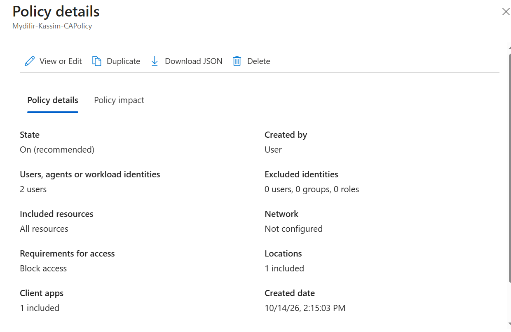
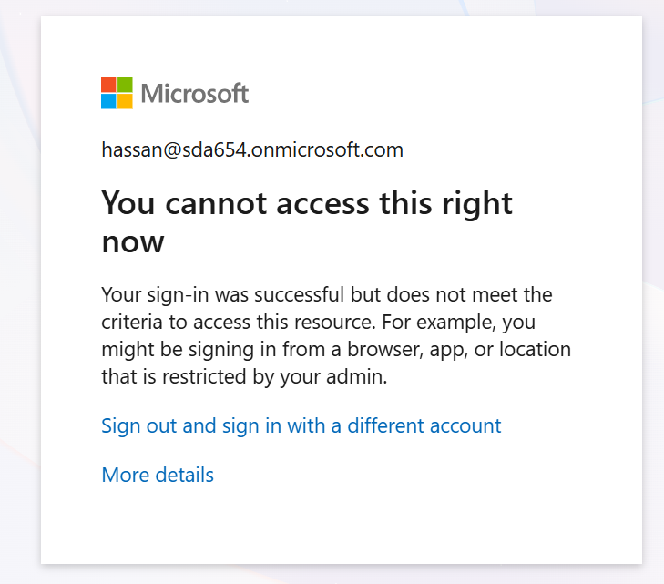
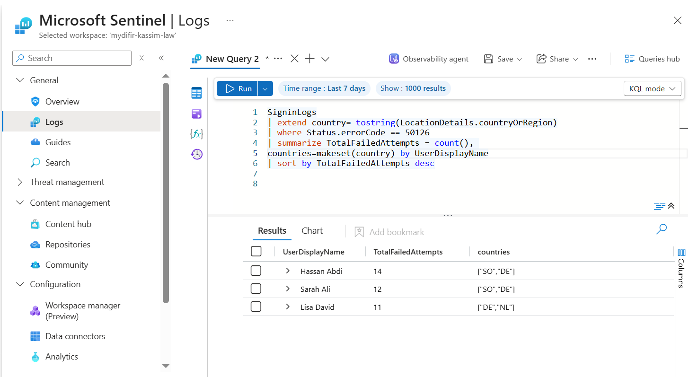

## Week Four: Identity Security with Microsoft Entra ID and Microsoft Sentinel

During Week Four of my [30-Day MyDFIR Microsoft Challenge](https://github.com/Kassimali/30-Day-MyDFIR-Microsoft-Challenge/tree/main), I focused on identity security using Microsoft Entra ID and Microsoft Sentinel.

I explored identity protection features, sign-in and audit logs, Conditional Access policies, and how identity-related events can be investigated using KQL.

## Task 1: Explore Microsoft Entra ID and Identity Protection

I reviewed the Microsoft Entra admin center and became familiar with its identity management and protection features.

### Identity Protection

Microsoft Entra ID Protection helps organizations identify and investigate identity-based risks, including:

- **Unfamiliar sign-in locations:** Sign-ins from locations that are unusual for a user.
- **Impossible travel:** Sign-ins from locations that would be difficult to reach within the recorded time.
- **Password spray and brute-force activity:** Attempts to access accounts using repeated or commonly used passwords.
- **Compromised credentials:** Risk indicators associated with exposed or leaked credentials.
- **High-risk users and sign-ins:** Accounts or authentication attempts that Microsoft identifies as potentially compromised or suspicious.

These signals help security teams prioritize identity-related threats and investigate potentially compromised accounts.

### Sign-in Logs

Sign-in logs provide information about authentication attempts, including successful, failed, and interrupted sign-ins.

They help answer questions such as:

- Who attempted to sign in?
- When did the sign-in occur?
- Where did the sign-in originate?
- Was the authentication successful?
- What Conditional Access policies were evaluated, and what were their results?

From a SOC analyst's perspective, sign-in logs are valuable for investigating suspicious authentication activity, password attacks, and unusual access patterns.

### Audit Logs

Audit logs record activities performed within Microsoft Entra ID, helping analysts investigate administrative and directory changes.

Examples include:

- User and group membership changes.
- User role assignments and modifications.
- Changes to authentication methods and MFA registration.
- Creation, modification, or deletion of policies.

These logs are particularly useful when investigating potential account compromise or persistence. For example, an unauthorized actor who gains access to an account may attempt to modify authentication methods, add privileged roles, or change security settings.

### User Risk vs. Sign-in Risk

I also explored the difference between user risk and sign-in risk.

- **User risk:** Microsoft's assessment of the likelihood that an identity has been compromised, based on available risk detections.
- **Sign-in risk:** Microsoft's assessment of the likelihood that a particular authentication attempt was not performed by the legitimate account owner.

Understanding this distinction helps analysts determine whether they should investigate a specific login, a potentially compromised account, or both.

## Task 2: Configure and Test a Conditional Access Policy

Conditional Access allows organizations to enforce access decisions based on conditions such as user identity, location, device state, application, and sign-in risk.

For this exercise, I created a Conditional Access policy designed to block sign-ins originating from a country where the organization does not conduct business.

### What I Did

1. Opened the Microsoft Entra admin center.
2. Navigated to Conditional Access and configured a named location representing the country to be blocked.
3. Created a Conditional Access policy targeting the intended test users and cloud applications.
4. Configured the policy to block access when the sign-in originated from the specified location.
5. Simulated a foreign sign-in using a VPN.
6. Reviewed the sign-in logs to verify whether the policy was applied and access was blocked.

Before testing, I reviewed the existing policies and their effects on the lab accounts to avoid unnecessary disruption.

### Results

I reviewed the sign-in logs to determine whether the test sign-in matched the configured location and whether Conditional Access blocked the authentication attempt.

The screenshots document the policy configuration and the foreign sign-in test. The final finding should be based on the actual sign-in result and Conditional Access details shown in the portal.

## Task 3: Connect Microsoft Entra ID Logs to Microsoft Sentinel

To centralize identity monitoring, I enabled the Microsoft Entra ID data connector in Microsoft Sentinel and explored the sign-in and audit logs available after ingestion.

I then used KQL to query identity-related events and investigate suspicious authentication patterns.

### Brute-Force Investigation

I explored how KQL can be used to identify repeated failed sign-in attempts, group events by account or source IP address, and identify patterns that may indicate brute-force activity.

Repeated failed sign-ins do not automatically confirm an attack. Analysts must examine the time window, source addresses, affected accounts, successful sign-ins, and other available evidence before reaching a conclusion.

This exercise helped me understand how identity logs can support threat hunting and incident investigation in Microsoft Sentinel.

## Screenshots and Evidence

The following screenshots document my hands-on activities:

**Conditional Access Policy Configuration** 

2. **Foreign Sign-in Blocked** 

 **KQL Query for Brute-Force Detection** 

 

## What I Learned

During Week Four, I gained practical experience exploring Microsoft Entra ID, understanding identity risk, configuring Conditional Access, and investigating authentication events.

I also learned how Microsoft Sentinel can help security analysts investigate identity-based threats by querying sign-in and audit logs with KQL.

Most importantly, this exercise helped me understand that identity security involves more than protecting passwords. It also requires monitoring authentication behavior, reviewing changes to accounts and security settings, enforcing access policies, and investigating suspicious activity.

This concludes my fourth week of hands-on work in the 30-Day MyDFIR Microsoft Challenge.